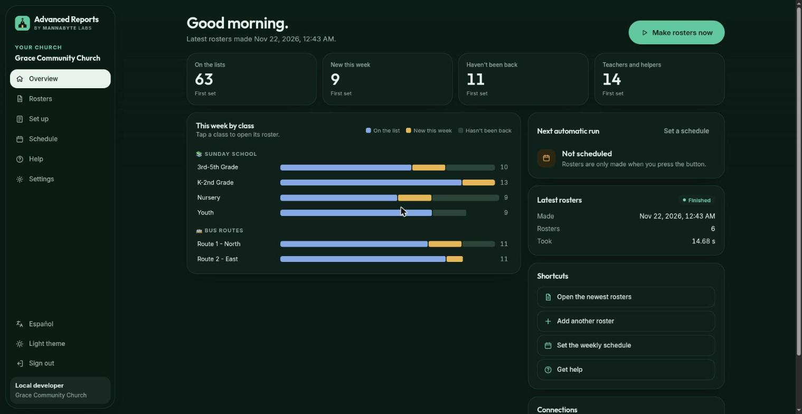
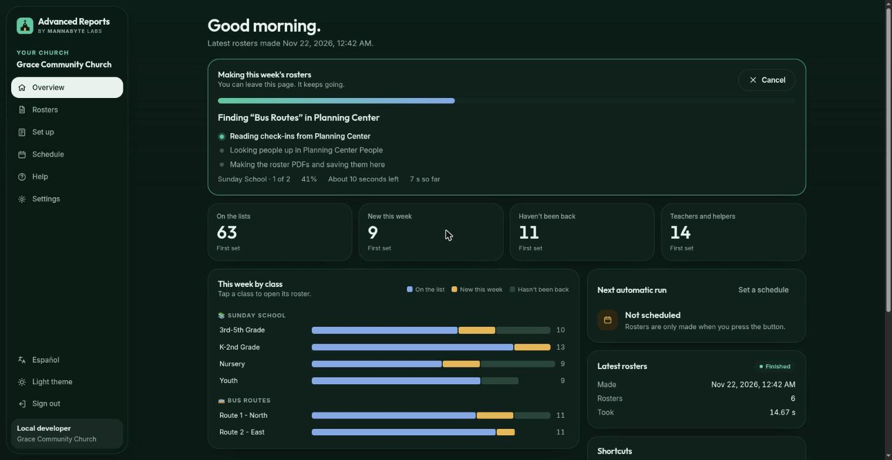
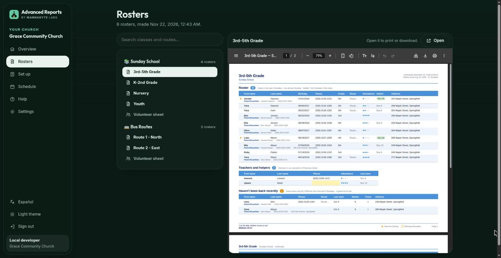
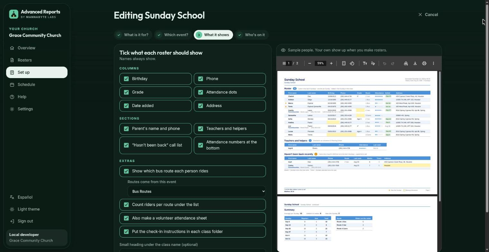
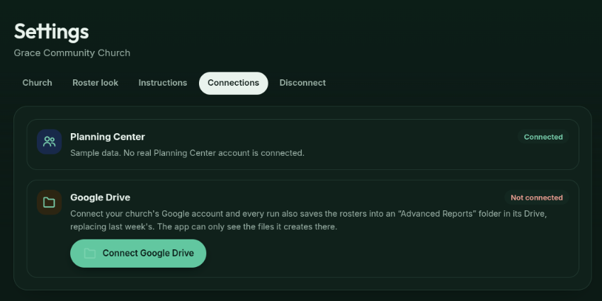
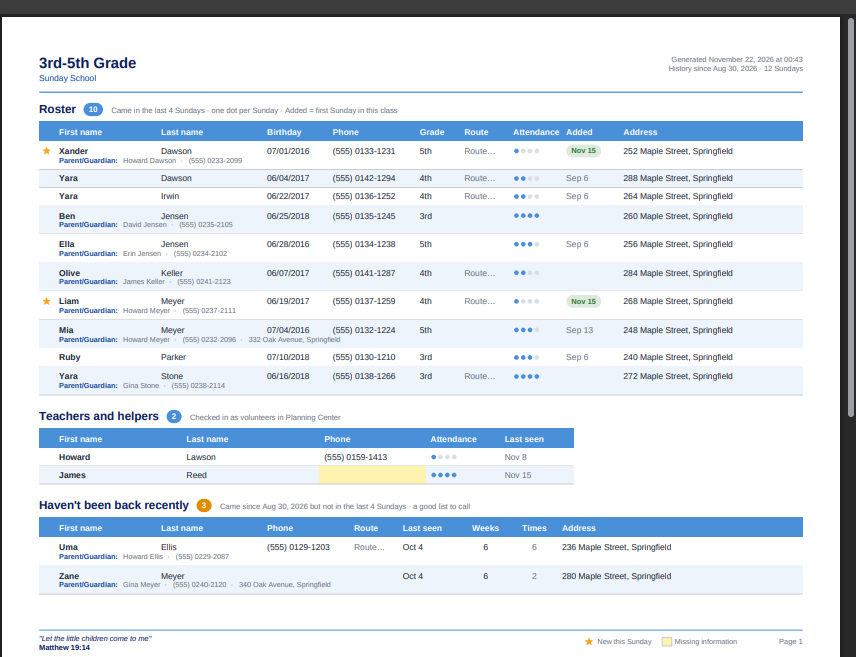
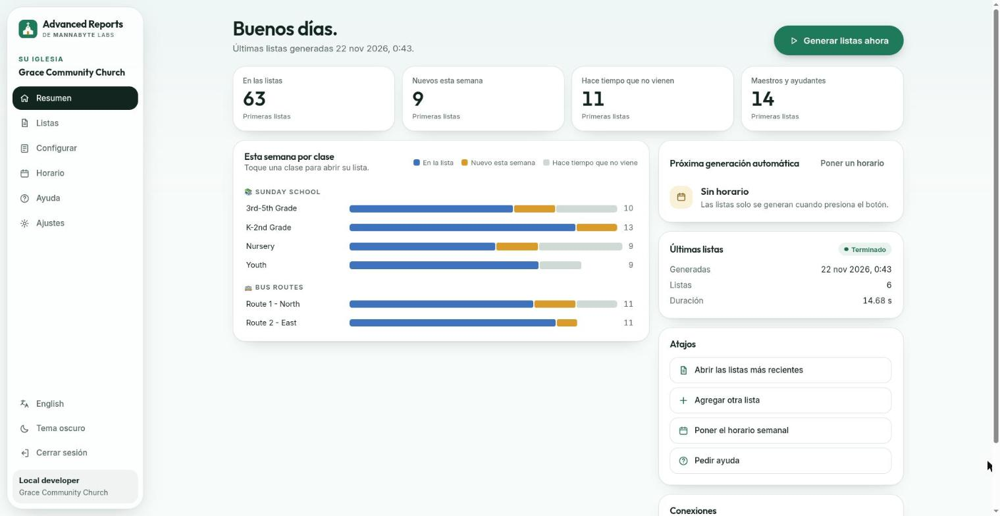
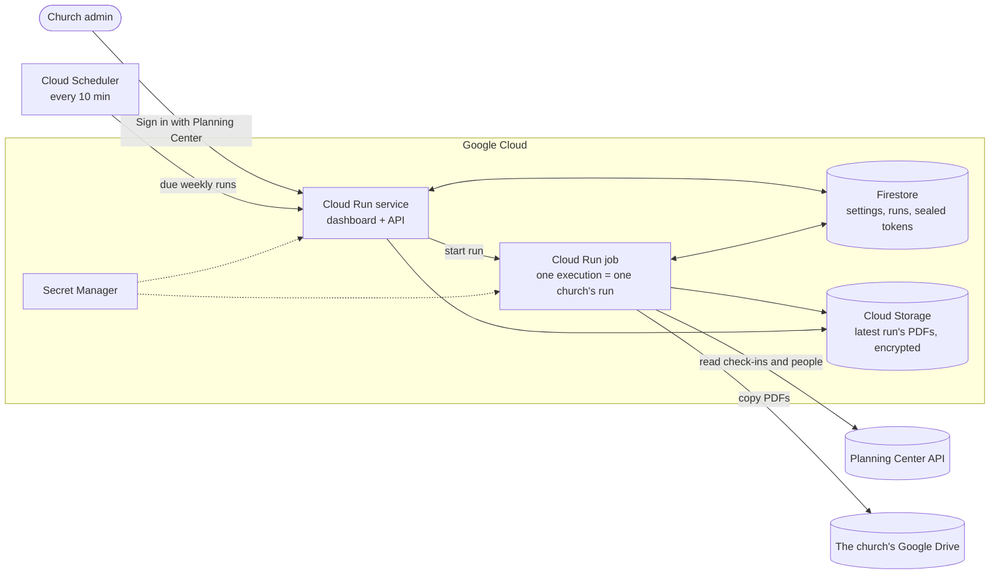

# Planning Center Check-Ins — Roster System → Advanced Reports for Planning Center

Automatically generates PDF rosters from [Planning Center](https://www.planningcenter.com/) check-ins
and delivers them every week. It started as a single-church tool for a bus ministry (still running
in production, documented further down) and is becoming **Advanced Reports for Planning Center**: a
hosted, multi-church platform where a church signs in with Planning Center, picks its events, and
gets clean rosters in its own Google Drive, with no setup on anyone's laptop.

---

## Advanced Reports (the platform)



**Status (November 2026):** working end to end on Google Cloud staging. A church admin signs in
with Planning Center (OAuth, no API keys), sets up rosters in a wizard, presses *Make rosters
now* (or sets a weekly schedule), and the PDFs appear in the dashboard and in an *Advanced
Reports* folder in the church's own Google Drive. The first real run made 31 rosters for a church
of ~500 children in 88 seconds.

| | |
|---|---|
|  |  |
| **Live progress.** Stages, a percentage and time left, even on a church's first run. Runs keep going if you close the page, and can be cancelled. | **Rosters.** Every class and bus route, ready to open, print or download. |
|  |  |
| **Set up in minutes.** Pick a Check-Ins event, tick what each roster shows, see a live preview with sample people. | **Your Drive, your data.** Connect Google Drive with the narrowest permission Google offers: the app only sees files it creates. |



*A roster: attendance dots, new-this-Sunday stars, a parent line under each child, teachers and
helpers, a "haven't been back" call list, and yellow highlights where information is missing.
All screenshots use made-up sample people.*

The dashboard is bilingual (English/Spanish) with light and dark themes, and works on a phone:



### How it works



- **One run = one church.** Each run is its own Cloud Run job execution that loads only that
  church's settings and keys. Every storage path starts with `churches/{org_id}`, and tests prove
  two churches can't read, list, run or download each other's data.
- **Encrypted per church.** Each church has its own data key (AES-GCM), wrapped by a master key in
  Secret Manager. Planning Center and Google tokens and every stored PDF are sealed with it.
  Only the latest run's PDFs are kept.
- **Fast and light on Planning Center.** Person details come with the check-ins and parents are a
  batched lookup, so a weekly run is ~200 requests instead of thousands (the first version
  spent ~40 minutes of job time a week; a run now takes about a minute and a half).
- **Free-tier first.** Firestore, Cloud Run with zero idle instances, one scheduler job and a small
  bucket. One deploy script sets it all up: `bash deploy/platform.sh staging|prod`.
- **Read-only.** The platform never changes anything in Planning Center.

Code: `backend/advanced_reports/` (platform), `backend/planning_center_reports/` (the report
engine, shared with the original tool). Start with [`CLAUDE.md`](CLAUDE.md) and
[`docs/advanced-reports-plan.md`](docs/advanced-reports-plan.md).

### Roadmap

| When | What |
|---|---|
| ✅ Nov 2026 | Multi-church engine, platform core, dashboard, Planning Center sign-in, Firestore, Cloud Storage, Cloud Run deploy, Google Drive delivery, live progress |
| Next | Privacy policy and terms; custom domain; publish the Google app; production deploy; IBL runs side by side with the old job, then switches |
| Dec 2026 | Faster runs (parallel requests, then a synced data store so a run only fetches the newest week); onboard a second church |
| Then | **Bus/Van Route Builder**, **Grade Promotion Helper** (audit report first), **Google Sheets sync** |
| Jan 2027 | Public launch: setup guide and video, Planning Center community and integrations directory |

The full plan, decisions and status live in [`docs/advanced-reports-plan.md`](docs/advanced-reports-plan.md);
the step-by-step launch checklist is [`docs/launch-guide.md`](docs/launch-guide.md).

---

## The original roster tool (single church, in production)

Everything below documents the original setup: one church, configured by `.env` and
`reports.yaml`, running as a weekly Cloud Run job, with a React/FastAPI admin UI. It keeps running
unchanged until that church moves to the platform.

## Live Demo

**Not sure if this fits your church's workflow? Try it before setting anything up.**

> **[→ Open the live demo](https://roster-api-demo-k3lvrupgua-uc.a.run.app/)** — no login, no credentials, no download required.

The demo runs the full web UI against mock data: trigger any configured roster job, watch the log output stream in real time, and preview the generated PDFs. It's the real application — just with fake attendees instead of your church data.


---

## Quickstart

```bash
# 1. Clone
git clone https://github.com/ismaeldiaz1213/planning-center-check-ins-reports.git
cd planning-center-check-ins-reports

# 2. Create your environment file
cp .env.example .env
# Open .env and fill in PCO_APP_ID, PCO_SECRET, GOOGLE_DRIVE_PARENT_FOLDER_ID

# 2b. (Optional) Define your reports — defaults to Rutas + Escuela Dominical
cp reports.yaml.example reports.yaml

# 3. Install backend dependencies
cd backend
python -m venv .venv && source .venv/bin/activate
pip install -r requirements.txt -r requirements-web.txt -r requirements-dev.txt

# 4. Run tests (no credentials needed)
pytest && ruff check .

# 5. Generate sample PDFs (no credentials needed)
python preview.py --open

# 6. See what reports are configured, then run one
python main.py --list-reports
python main.py rutas
```

See [docs/getting-started.md](docs/getting-started.md) for the full walkthrough, and
[docs/reports.md](docs/reports.md) for how to configure which reports get generated.

---

## Features

- **Configurable reports** — define any number of Check-Ins events in `reports.yaml`; bus routes, volunteer reports, and instructions are optional per report, so a church without a bus ministry never sees a `Ruta` column
- **Full-history rosters** — each class looks back to back-to-school Sunday (or a rolling window, e.g. a quarter for bus routes): **date added**, attendance dots, a **"Hace tiempo que no viene"** follow-up list of people who stopped coming, and a **Resumen** with per-Sunday numbers
- **Parents on the roster** — each kid's household contact (adults only), with phone and address
- **Workers table** — whoever Planning Center tags as *Volunteer*, kept apart from the kids
- **Volunteer attendance sheet** — who served each Sunday last month and when they checked in
- **Instrucciones.pdf** — bilingual check-in guide with a QR code to the video, next to every roster
- **Feedback form** — linked from every page, with a QR code for printed copies
- **Yellow highlights** for missing data (phone, birthday, address, grade)
- **Fast and light on Planning Center** — contact details come with the check-ins; parents are a batched lookup; every report runs in one weekly job in under a minute
- **Campaign themes** — seasonal colour schemes for special events
- **Web UI** — dashboard for triggering jobs, previewing PDFs, editing settings, and viewing logs
- **Demo mode** — deploy a public `DEMO_MODE=true` instance so developers can evaluate the app without credentials
- **Google OAuth login** — restrict access to your church's Google Workspace domain
- **Fully automated** via Google Cloud Run + Cloud Scheduler
- **Grade promotion** — move a Sunday school class up a grade in Check-Ins pre-select
  history ahead of promotion weekend (`backend/promote_checkins.py`)
- **Roster to pre-select** — check a class roster spreadsheet into a class for last
  Sunday, for any church, reporting names that don't match Planning Center
  (`backend/checkin_people_list.py`, see [docs/check-in-tools.md](docs/check-in-tools.md))

---

## PDF Output

Every class and bus route folder in Google Drive receives:

| File | Description |
|------|-------------|
| `Roster.pdf` | **Lista** (with parents, date added and attendance), **Maestros y ayudantes**, **Hace tiempo que no viene** (follow-up list) and a **Resumen** (per-Sunday counts, kids per route). |
| `Instrucciones.pdf` | Bilingual check-in guide; re-uploaded only when it changes. |

Each report also gets `Voluntarios/<report>/Voluntarios.pdf` — volunteer attendance and check-in times over the
last 4 Sundays. See [docs/reports.md](docs/reports.md#what-each-report-produces).

### Column Reference

| Column | Notes |
|--------|-------|
| ★ / ⚽ | First time this Sunday — gold star by default; soccer ball PNG for the `primavera` theme |
| Nombre / Apellido | First and last name; kids get a **Padre/Tutor** line underneath |
| Cumpleaños | Birthday in MM/DD/YYYY format |
| Teléfono | Primary phone number |
| Grado | PCO grade field; auto-filled as Nursery / 3 años / 4 años for children under 5 |
| Ruta | Bus route most recently ridden — Sunday school rosters only |
| Asistencia | One dot per Sunday in the active window; filled = present |
| Agregado | First Sunday in this class (green if recent; blank = regular since the start) |
| Dirección | Address without state/ZIP |

**Yellow highlighting** means the cell is missing or incomplete — phone, birthday, grade (for minors), and bad/city-only addresses all trigger this.

---

## Campaign Themes

Pass `--theme` to apply a seasonal colour scheme:

```bash
python main.py rutas --theme primavera
python main.py rutas --theme verano
python main.py rutas --theme otono
python main.py rutas --theme invierno
```

| Theme | Colours | Label | Visitor marker |
|-------|---------|-------|----------------|
| *(none)* | Navy/blue | — | Gold dot |
| `primavera` | Greens | Campaña de Primavera | Soccer ball PNG |
| `verano` | Orange/red | Campaña de Verano | Gold dot |
| `otono` | Brown/tan | Campaña de Otoño | Gold dot |
| `invierno` | Deep indigo/blue | Campaña de Invierno | Gold dot |

---

## Documentation

- [Getting Started](docs/getting-started.md) — clone, configure, run tests, generate PDFs
- [Report Configuration](docs/reports.md) — `reports.yaml`: defining reports and their optional features
- [Configuration Reference](docs/configuration.md) — all environment variables, PCO permissions, Drive setup, logo
- [Deploying to Google Cloud](docs/deployment-gcp.md) — Cloud Run jobs, manage.sh, web UI deploy
- [Grade Promotion](docs/grade-promotion.md) — moving a class up a grade in Check-Ins pre-select history
- [Sample Data & Previews](docs/sample-data.md) — preview.py flags and mock data editing
- [Check-In Tools](docs/check-in-tools.md) — seeding pre-select history from a roster spreadsheet, grade promotion, bus classes
- **Platform:** [Platform guide](docs/platform.md) (code map, running, deploying, operating) ·
  [Plan and status](docs/advanced-reports-plan.md) · [Launch guide](docs/launch-guide.md) ·
  [Benchmarks](docs/benchmarks.md)

For development workflow (running the test suite, Vite dev server, full-stack local setup),
see [DEVELOPMENT.md](DEVELOPMENT.md).

---

## Troubleshooting

| Problem | Fix |
|---------|-----|
| `429 Too Many Requests` | Script auto-retries with exponential backoff. Wait for it. |
| `SSL EOF / ReadTimeout` | Auto-retries up to 7 times. If persistent, try again later. |
| `Event 'X' not found` | Event name is case-sensitive — check exact name in PCO Check-Ins. |
| `No such file: main.py` in Cloud | Job is using a stale image. Run `manage.sh → option 6`. |
| `FileNotFoundError: credentials.json` in Cloud | Run **both** `manage.sh → option 5` (uploads the key to Secret Manager and points the job's `--set-secrets` at it) **and** `option 6` (rebuilds the image so the code that reads `GOOGLE_APPLICATION_CREDENTIALS` is actually deployed). Option 5 alone updates config only — it doesn't rebuild the image. |
| PDFs not appearing in Drive | Confirm service account has Editor access to the Drive folder. |
| Job timed out | Each report's job has a 3600s (1 hour) limit. Should be sufficient for any church size. |
| Theme not applying | Run both build + job update, or use `manage.sh → option 6` which does both. |
| `unrecognized arguments: --theme primavera` | `--args` requires comma-separated tokens, not spaces: `--theme,primavera`. |
| `promote_checkins.py` checks people into the wrong Sunday/time | Confirm `--weeks`/`--time` match what you expect, and run `--list-locations` to rule out a typo'd class name silently matching nothing (it raises instead, but double-check `--from-location`/`--to-location` spelling). |

---

## Schedule

| Job | Cron | Default time |
|-----|------|-------------|
| Bus routes | `0 8 * * 1` | Monday 8:00 AM UTC (2:00 AM CST) |
| Sunday school | `0 8 * * 1` | Monday 8:00 AM UTC (2:00 AM CST) |

---

## Security

- **Never commit** `.env` or `credentials.json` — both are in `.gitignore`
- `credentials.json` is supplied at runtime via Secret Manager — not baked into any Docker image
- PCO credentials live in Google Secret Manager — never in the image
- Rotate your PCO token at **https://api.planningcenteronline.com/oauth/applications** if exposed
- Rotate your service account key in Cloud Console → IAM → Service Accounts if exposed
- See [SECURITY.md](SECURITY.md) for the full security policy and vulnerability reporting
